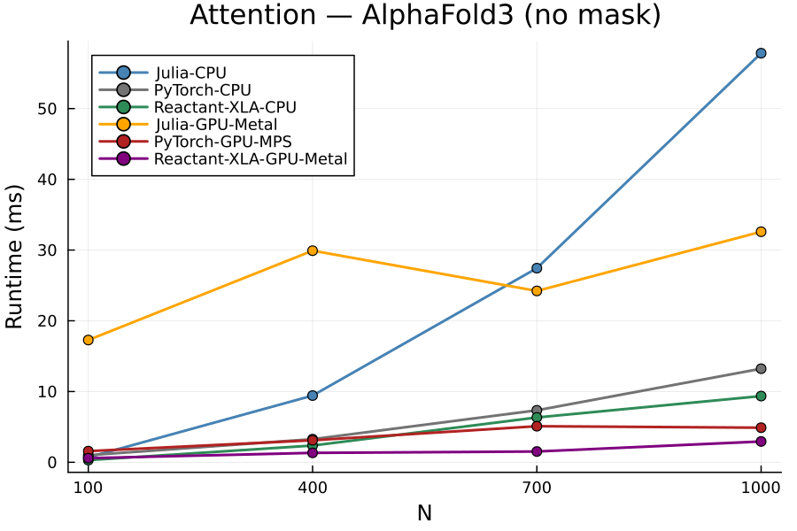
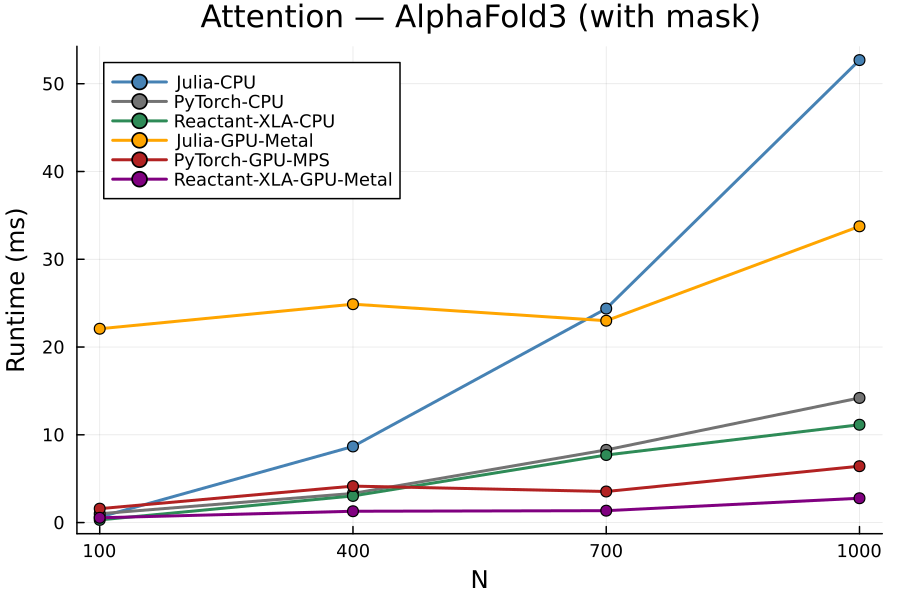

# LuxTriangleAttention.jl

Triangle Attention and Triangle Multiplication layers for [Lux.jl](https://github.com/LuxDL/Lux.jl), built for protein structure prediction models such as AlphaFold and Boltz.

## Benchmarks

Runtime of the `Attention` layer (pair-bias, `bias_layout=:kq`) vs. the OpenFold-3 PyTorch reference, across Julia CPU (+ AppleAccelerate), Julia GPU (Metal.jl), Reactant/XLA (CPU and GPU via the jax-mps PJRT plugin), and PyTorch (CPU and MPS). Lower is better.

<p align="center">
  
  
</p>

For any number of residues N, XLA-optimized julia code outperforms the PyTorch implementations on both CPU (10-20%) and Metal GPU (roughly 2x). 

System info:

```
System Version: macOS 26.6 (25G72)
Kernel Version: Darwin 25.6.0
Model Name: MacBook Pro
Model Identifier: MacBookPro18,1
Chip: Apple M1 Pro
Memory: 32 GB
```

Benchmarks are generated by `test/attention.bench.jl`.

## Features

- **Triangle Attention** — Starting and Ending axial attention with triangle bias (AlphaFold Algorithms 13 & 14).
- **Triangle Multiplication** — Outgoing and Incoming triangle multiplication (AlphaFold Algorithms 11 & 12).
- Built natively on `Lux.jl`, using `Lux.scaled_dot_product_attention` and `Lux.batched_matmul` for performance.
- Gated attention and Gated Linear Units (GLU / SwiGLU) support.
- Numerically verified against reference PyTorch implementations (AlphaFold2, AlphaFold3, Boltz2) across precisions and input configurations.

## Installation

```julia
using Pkg
Pkg.add("LuxTriangleAttention")
```

## Quick Start

### Triangle Attention

```julia
using Lux, LuxTriangleAttention, Random

# [Channels, Ni, Nj, Batch]
x = randn(Float32, 64, 32, 32, 1)

model = TriangleAttention(
    64,      # input channels
    32,      # head dimension
    4;       # number of heads
    is_starting=true # true for Starting Node, false for Ending Node
)

rng = Random.default_rng()
ps, st = Lux.setup(rng, model)

y, st = model(x, ps, st)
```

### Triangle Multiplication

```julia
model = TriangleMultiplication(
    64,      # input channels
    128,     # hidden channels
    is_outgoing=true # true for Outgoing, false for Incoming
)

y, st = model(x, ps, st)
```

## Layer Details

### Triangle Attention
Axial attention over the pair representation, incorporating a triangle bias:
- **Starting Node**: attends over the $j$ dimension.
- **Ending Node**: attends over the $i$ dimension.

Input shape is `[C, Ni, Nj, B]`, queries are `[D, H, Ni, Nj, B]`. This implementation attends over the **3rd** dimension (`token_dim=3`), which differs from some Python implementations (e.g. AlphaFold, Boltz) that attend over the 4th.

### Triangle Multiplication
Updates the pair representation by combining edges sharing a common node:
- **Outgoing**: $`\mathbf{z}_{ij} = \sum_k \mathbf{a}_{ik} \odot \mathbf{b}_{jk}`$
- **Incoming**: $`\mathbf{z}_{ij} = \sum_k \mathbf{a}_{ki} \odot \mathbf{b}_{kj}`$

## Masking and Bias

### Boolean Masking
Masks of shape `[N, B]`, `[Ni, Nj, B]`, or `[N, S, B]` are reshaped automatically to fit the internal attention score format.

```julia
# Sequence padding mask, [N, B]
mask = rand(Bool, 32, 1)
y, st = model((; x, mask), ps, st)

# Pairwise mask, [Ni, Nj, B]
mask_ij = rand(Bool, 32, 32, 1)
y, st = model((; x, mask=mask_ij), ps, st)
```

### Attention Bias and Layouts (`prep_bias`)

`prep_bias` shapes a custom attention bias tensor according to the `Attention` layer's `bias_layout`:

- **`bias_layout=:qk`** — symmetric/triangle layout, used by `TriangleAttention`. Input `[C, Ni, Nj, B]`, bias `[H, Ni, Nj, B]`, permuted internally to `[Ni, Nj, H, 1, B]`.
- **`bias_layout=:kq`** — asymmetric/pair layout, used by `AttentionPairBias` and other pair-bias cases. Input `[C, N, S, B]`, bias `[H, Nq, Nk, B]`, permuted/transposed internally to `[Nk, Nq, H, 1, B]`.

```julia
x = randn(Float32, 16, 32, 32, 1)
bias = randn(Float32, 4, 32, 32, 1)

bias_qk = prep_bias(bias, x, :qk) # [Ni, Nj, Heads, 1, Batch]
bias_kq = prep_bias(bias, x, :kq) # [Nj, Ni, Heads, 1, Batch]

# Or pass through the layer directly (prep_bias is called internally)
y, st = model((; x, bias), ps, st)
```

## License
GNU General Public License
